# Zeflo (previously known as StudyFlow)

**Your study. Your schedule. Your flow.**

Zeflo is a calm study planner for students. Bring in your class timetable, plan study sessions around it (or ask your own AI to plan them for you), run a full-screen focus timer or clock for each one, and watch your streak and progress fill in — all on panes of liquid glass over a living scene, an ocean or a forest, that follows the real weather and time of day where you are, with sound to match.

**Live at [zeflo.vercel.app](https://zeflo.vercel.app)** · version 1.7.2

<p>
  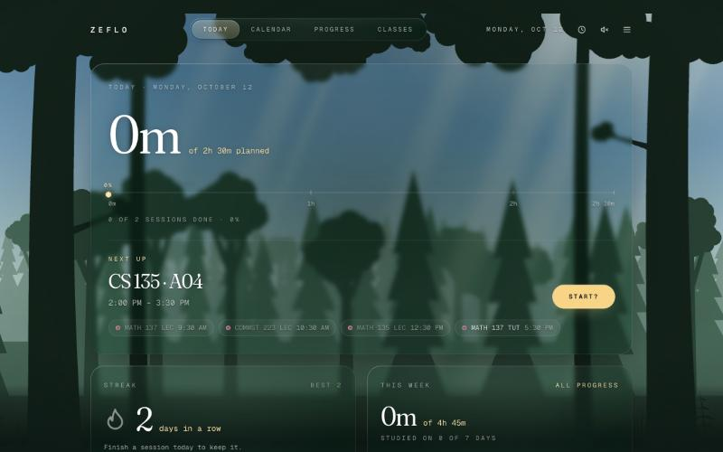
  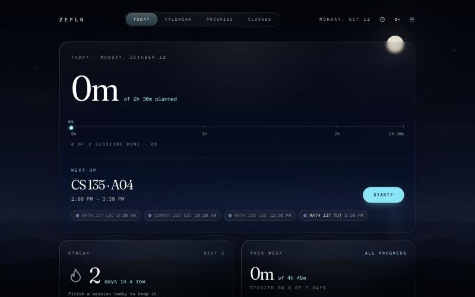
</p>
<p>
  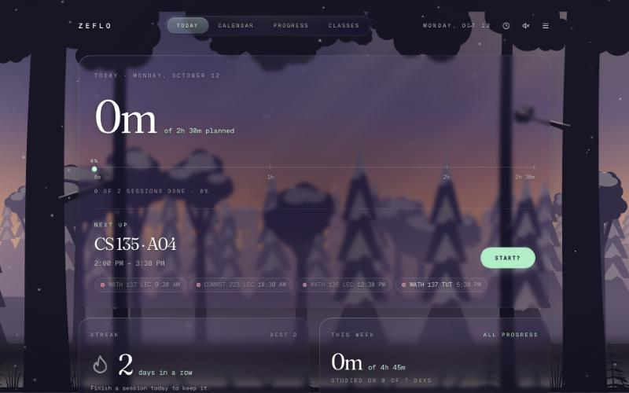
  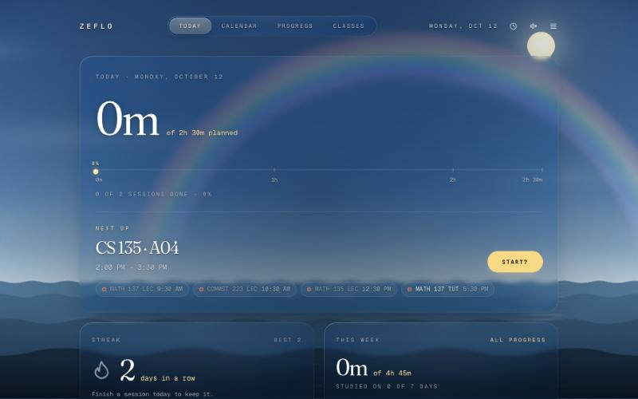
</p>

## Features

### Plan and focus

- **Getting around** — five sections: **Today**, **Calendar**, **Progress**, **Reminders** and **Classes**. On computers they're a pill along the top whose highlight slides (and stretches, like liquid) to the one you're on; on phones they're a floating tab bar at the bottom of the screen, in reach of your thumb.
- **Today** — the first thing you see when you log in. A large card for **today**: time studied out of planned (breaks excluded), a progress line, what's on **now** or **next** (with the time left) and a **Start** button for it, and today's classes. Then cards for your **streak** (with the last two weeks as a row of days), **this week** (done out of planned and a bar for each day), **today's sessions** (click one to tick it off), and **countdowns to your next tests and exams**, taken straight from your imported class schedule.
- **Calendar** — switch between **Day**, **Week** and **List** at the top. A **week view** of everything at a glance (classes and study sessions, Monday to Sunday) on tablets and computers, and an hour-by-hour **day view** with a live "now" line, which is what phones get. Step back and forward through weeks and days to plan ahead, with the arrows or by **swiping** (a finger on a phone or iPad, or two fingers on a trackpad); click any open time in the day view to add a session there, or press and drag to draw it at exactly the right length; then type its name right in the block and press Enter. Drag the block to move it, its top and bottom edges to change the times, or click a time to pick it exactly (on phones a panel slides up instead). The × on a session removes it, and overlapping sessions sit side by side. **List** shows today's sessions with an add form, and today's reminders. Reminders show on the day and week views too, as a bell at their time; tap one to open it.
- **Reminders** — your own to-dos, kept apart from study sessions: "Remind me to…", a day and a time. Right at that time a notification arrives (it stays on screen until you deal with it); tap it and Zeflo opens on that reminder, ready to tick off. Overdue ones wait under **Due**, and finished ones stay under **Done** for a week.
- **Classes** — bring in your class schedule from any school, three ways:
  - **Paste it** from your school's portal. Pick your school for step-by-step help: Waterloo (Quest's list view), TMU (MyServiceHub's View My Classes), York (course timetable rows, with a start time and a length in minutes), or any other school, including other PeopleSoft portals and plain lines like `CS 135 LEC MWF 10:30-11:20 MC 2065`.
  - **Upload a calendar file** (.ics) exported from your portal or calendar app. Weekly events become classes, a one-off event that names a course (a midterm) becomes a test, and anything that isn't a course starts unticked.
  - **Let your AI read it**: copy Zeflo's prompt into ChatGPT, Claude or any AI with your schedule, as text or a **screenshot**, and paste back what it writes. It works for any portal, even a calendar grid.

  Zeflo finds each course's lectures, tutorials and labs with their days, times, rooms and term dates, lets you untick anything it got wrong, and shows them on the calendar on the days they meet, in their own bold colour that changes with the scene. New accounts are asked whether they'd like to add their classes; after that it's the **Classes** section (also in **Settings → Classes**).
- **Progress** — your **streak** (days in a row with a study session done; the flame lights up once today counts), a GitHub-style grid of the **last six months** shaded by how much you got done, and a closer look at any **week** (swipe to move between weeks): done against planned for each day, and a breakdown **by course** ("CS 135 assignment" and "CS 135 lab prep" both count for CS 135).
- **Start? — timer or clock** — pressing **Start?** on a session asks whether you want the study timer or the clock. The first time you choose, it asks once whether to make that your default; either way it never asks again, and you can change it any time in **Settings → Focus**.
- **Focus timer** — a full-screen countdown of the session's length. Pause with the button or the space bar, take a break (10, 20, 30 minutes or your own length), add 10 more minutes when time's up, and press **Done** for a little celebration. The timer survives reloads and leaving the page, and the tab title shows the time left. Once a session's timer is going, its **Start?** becomes **Continue** with the time left (or "paused", "on break", "time's up"), and a **Studying … · Continue** pill under the header takes you back to the timer from any page.
- **Clock** — a full-screen clock over the scene, for when you just want the time and the view (the clock button in the header, or from Start?). Swipe (a finger, or two fingers on a trackpad), drag, use the arrow keys or the dots to choose a style: **Classic** big numbers, an **Analog** dial with a sweeping second hand, the time in **Words** ("just after twenty-five past two"), **Orbit** rings for hours, minutes and seconds, or a **Sun path** showing where the sun or moon is in its arc. Your style is saved to your account, and Classic can show the seconds as numbers instead of a line (the small toggle under it). Opening the clock draws the scene in around you — deeper colour and contrast, a gentle zoom and a soft vignette — and the time sharpens into view. The controls fade away when you're not moving the mouse, it can go full screen, and it keeps the screen awake. Opened from a session, it shows that session (with a progress line that moves smoothly) and a **Done** button.
- **Reminders** — a notification **before each study session** (5, 10, 15 or 30 minutes ahead, or off), at 6 PM **the evening before a test**, and at 8 PM when **your streak** needs a session today, even when Zeflo is closed. Turn them on per device in **Settings → Reminders** (or from the card on Today), choose what you want reminded about once for all your devices, and send yourself a test. They follow your time zone, and logging out stops them on that device.
- **Get the app** — Zeflo isn't in an app store; it installs from the browser. Add it to an iPhone's Home Screen and it opens like an app: full screen, no browser toolbar, its own icon and place in the app switcher (that's also what lets an iPhone show reminders). On a computer it gets its own window and a place in the Dock or taskbar. A popup on Today offers it once per device, and **Settings → Get the app** shows the steps for whatever's in your hand: iPhone (any browser), Android, Safari on a Mac (Add to Dock), or a one-click **Install** in Chrome and Edge.
- **One thing at a time** — new accounts are offered their class schedule, then the app, then reminders, never two at once and nothing more once you've said Not now in a visit. The "No problem" note fades away on its own.
- **Time and date pickers** in the site's own style — hour, minute and AM/PM columns for times, and a month calendar for term dates, both with full keyboard support.
- **Your own account** — sign up with an email and password, and confirm it from a Zeflo email whose link works on any device (password resets work the same way). Your classes, each day's schedule, what you've finished, and your theme, sound and clock settings are saved to your account, private to you, and follow you between devices. Logging out signs out only that browser, so your other devices and your connected AI stay signed in. **Settings → Delete account** removes the account and everything in it straight away, after you type DELETE to confirm. On iPhone, Zeflo runs edge to edge: the scene fills the screen under Safari's toolbar, the strip behind the status bar takes the colour of the top of the scene (the sky, or the forest canopy) and fades into it, and everything you tap stays clear of both. Visitors who aren't logged in see a welcome page that shows how Zeflo works as they scroll: a 3D model of the planner where a pasted timetable drops in as classes, an AI fills the gaps with study sessions, a session rises into the focus timer, the real scene behind the page runs from sunrise to snow at midnight, and a streak builds. Each chapter is a resting point, so the page glides onto it when a scroll ends and a fast flick can't skip one (the model stays flat and fades for people who prefer reduced motion). The [privacy policy](https://zeflo.vercel.app/privacy), [terms](https://zeflo.vercel.app/terms) and [support](https://zeflo.vercel.app/support) pages are open to everyone.

<p>
  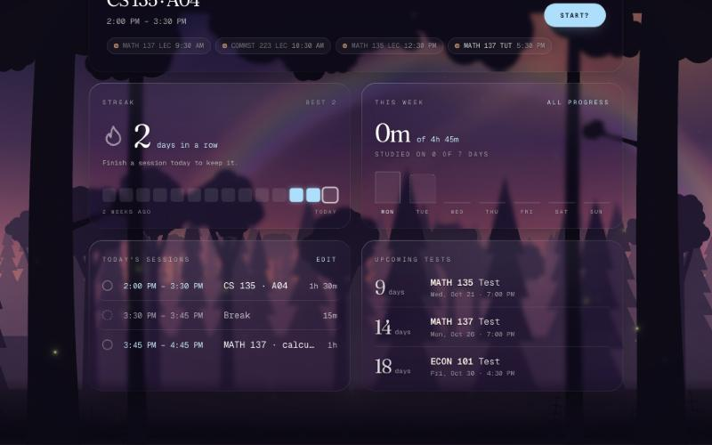
  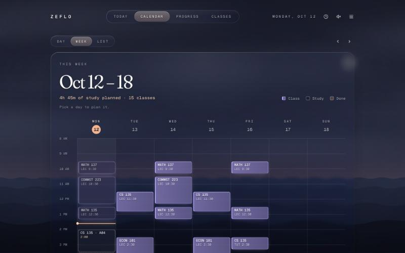
</p>
<p>
  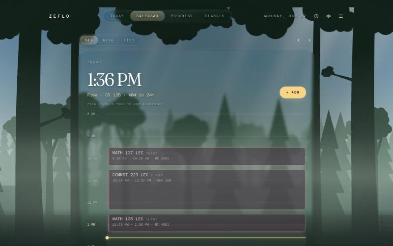
  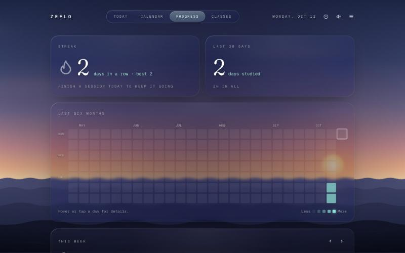
</p>
On an iPhone 17, in Safari with the offer to add Zeflo to the Home Screen, then as the installed app (full screen, no browser around it):

<p align="center">
  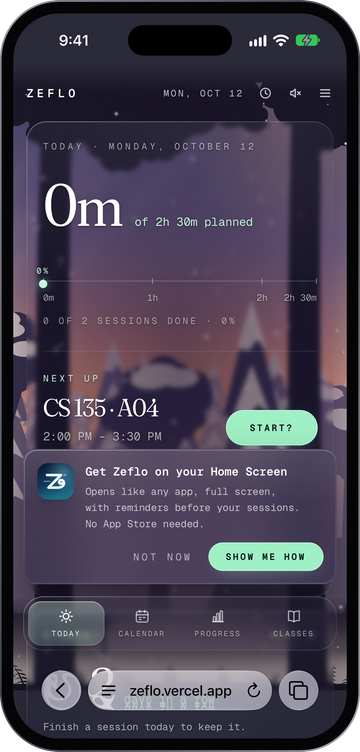
  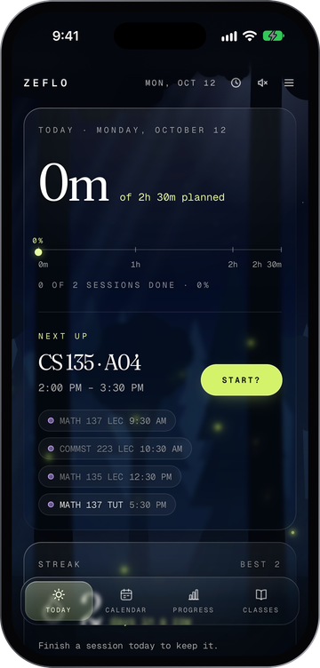
  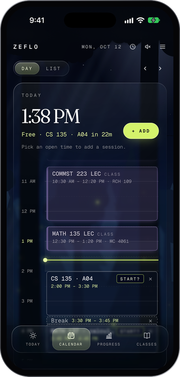
  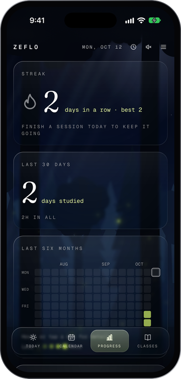
</p>

<p>
  
  
</p>

### Your AI, connected

Zeflo works with the AI you already use. Connect Claude (free plans included) or another assistant that supports custom connectors once, then just talk to it:

- *"Plan study sessions for my next test, around my classes."*
- *"I'm free tomorrow afternoon. What should I study, and when?"*
- *"Look at what I finished this week and plan next week better."*

It reads your classes, upcoming tests, study sessions, reminders and streak, then adds, moves or ticks off sessions and reminders right in Zeflo, spreading work for a test over the days before it and warning you about clashes. Because it's your own AI, it learns how you study and plans better the more you use it.

- **Set up in a minute** — **Settings → Your AI** has the connector address, the steps for your assistant, and prompts to try.
- **You stay in charge** — you approve each assistant on a Zeflo page that spells out what it can and can't do, and disconnect it any time from the same place. Assistants can read but never change your classes or settings: the database itself enforces that.
- **ChatGPT** is in progress.

<p align="center">
  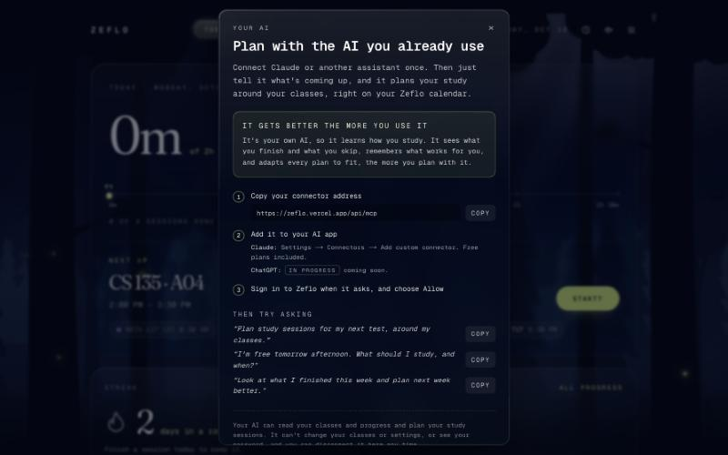
</p>

### Themes

Pick a theme in **Settings → Theme**:

- **Ocean** — open sky over rolling, animated water.
- **Forest** — layered trees under an overhanging canopy, with light shafts falling through the gaps, drifting dust, fireflies after dark, and **wildlife that comes and goes**: birds, butterflies and a rabbit by day, deer at dawn and dusk, bats at dusk, and an owl and a fox at night.

Each theme has its own **timer font** for a completely different feel — a thin, airy sans by the ocean; a soft, chunky storybook serif in the forest — and the app's **accent colour** (progress bar, buttons, the timer) changes with the scene, picked to stand out against that sky. Classes get a second colour from the other side of the colour wheel (violet against the cyan night sea, coral against a gold day, ember against a blue forest dusk), filled more strongly in fog and snow so they stay easy to read.

<p>
  
  
</p>

### Weather and time of day

- **Four times of day** — sunrise, day, dusk and night, from your local sunrise and sunset.
- **Six weathers** — clear, cloudy, rain, storm (lightning, with thunder that follows it), snow and fog, from your current local weather.
- **Snow builds up** gradually: it settles on the ground and the trees over a couple of minutes, and piles up along the bottom of the timer while you focus.
- **A rainbow** appears for a while when rain or a storm clears.
- Choose **Auto** to follow the weather where you are (no location prompt: see below), or pick any weather and time yourself.

### Sound

Every scene has its own soundscape, all synthesized in the browser (there are no audio files): waves, wind, rain and thunder; gulls, a buoy bell and a foghorn at sea; rustling leaves, birdsong, a woodpecker, crickets, frogs and owls in the forest. Animals you can see make their own sounds — the owl hoots, the deer's footsteps crunch through the leaves.

Turn sound on or off with the speaker button, and set **Master**, **Ambience**, **Wildlife** and **Timer chime** volumes in **Settings → Sound**. Browsers only allow audio after you interact with the page, so sound starts on your first click.

Everything cross-fades as it changes, and motion is reduced or turned off if your system asks for reduced motion. On a slower computer or a laptop on battery, turn on **Settings → Theme → Still scene**: the scene keeps its look but stops moving (falling weather and wildlife are hidden), which takes it to almost no CPU. It's saved per device.

## Getting started

Requires [Node.js](https://nodejs.org) 20.9 or newer.

```bash
git clone https://github.com/soccaskillz3-hub/zeflo.git
cd zeflo
npm install
```

Zeflo stores accounts and schedules in [Supabase](https://supabase.com) (free plan is fine). One-time setup:

1. Create a Supabase project. In **Project Settings → API Keys**, copy the project URL and the **publishable** key into a `.env.local` file in the project folder (it's ignored by git):

   ```
   NEXT_PUBLIC_SUPABASE_URL=https://your-project.supabase.co
   NEXT_PUBLIC_SUPABASE_PUBLISHABLE_KEY=sb_publishable_...
   ```

2. In the **SQL Editor**, run each file in [`supabase/migrations`](supabase/migrations) in order. They create the tables and the row level security rules that keep each account's data private.
3. In **Authentication → URL Configuration**, set the Site URL to where the app runs (`http://localhost:3000` locally) and add `http://localhost:3000/**` to the Redirect URLs, plus your deployed address once you have one.
4. Email, before anyone else signs up: Supabase's built-in email only sends a few messages an hour. In **Authentication → Emails → SMTP Settings**, turn on custom SMTP with any provider (Zeflo uses a Gmail account with an [app password](https://myaccount.google.com/apppasswords): host `smtp.gmail.com`, port `465`). Then, under **Templates**, paste [`supabase/templates/confirm-signup.html`](supabase/templates/confirm-signup.html) into **Confirm signup** and [`reset-password.html`](supabase/templates/reset-password.html) into **Reset password**. Their links work on any device, unlike Supabase's defaults, which only work in the browser that asked for the email. Finally, turn **Confirm email** on (Authentication → Sign In / Providers → Email).

5. Optional, for the AI connector: in **Authentication → OAuth Server**, turn on the OAuth 2.1 server, set the **Authorization Path** to `/oauth/consent`, and allow **dynamic client registration** (assistants like Claude register themselves). The connector lives at `/api/mcp`.

6. Optional, for reminders: create the keys that sign Zeflo's notifications with `npx web-push generate-vapid-keys`, and add them to `.env.local` (and your host's environment):

   ```
   NEXT_PUBLIC_VAPID_PUBLIC_KEY=...
   VAPID_PRIVATE_KEY=...
   REMINDERS_SECRET=...
   ```

   The reminders migration turns on `pg_cron` and `pg_net`, and makes a random secret in **Vault**. Copy that secret into `REMINDERS_SECRET` (the migration's last lines show how to read it). Every minute something is due, the database calls `/api/reminders` with it; if you deploy somewhere other than `zeflo.vercel.app`, change the address in the cron job too.

After at least two people have signed up, [`supabase/tests/privacy.sql`](supabase/tests/privacy.sql) checks in the SQL Editor that neither account can see or change the other's data.

```bash
npm run dev
```

Then open [http://localhost:3000](http://localhost:3000). Locally there's no Vercel to say where you are, so the scene shows a clear sky with your device's clock (or pick a weather in Settings).

| Command         | What it does               |
| --------------- | -------------------------- |
| `npm run dev`   | Start the dev server       |
| `npm run build` | Production build           |
| `npm start`     | Serve the production build |
| `npm run lint`  | Run ESLint                 |

In development, `window.__zefloSound` in the browser console exposes the audio mixer for debugging. It's left out of production builds.

## How weather and time work

Zeflo never asks for your location. Vercel, which hosts it, adds the rough area each request comes from (usually the city, from the connection) to the request; Zeflo rounds those coordinates to two decimal places (about 1 km) and asks [Open-Meteo](https://open-meteo.com) for the current weather code and today's sunrise and sunset, then refreshes every 30 minutes. Nothing is stored. **Settings → Theme → Weather & time of day** shows the city it's using.

- **Weather** comes from Open-Meteo's [WMO weather codes](https://open-meteo.com/en/docs#weather_variable_documentation), grouped into the six scenes.
- **Time of day**: sunrise runs from 45 minutes before to 75 minutes after sunrise; dusk from an hour before to 45 minutes after sunset; day and night fill the rest. When the area isn't known (e.g. running locally), sunrise and sunset are assumed to be 6:30 AM and 7:00 PM.

Open-Meteo's free API is for non-commercial use, which suits a personal project like this.

## Built with

- [Next.js 16](https://nextjs.org) (App Router) and [React 19](https://react.dev)
- [TypeScript](https://www.typescriptlang.org) and [Tailwind CSS 4](https://tailwindcss.com)
- The Web Audio API for every sound
- [Geist](https://vercel.com/font), [Jost](https://fonts.google.com/specimen/Jost) and [Fraunces](https://fonts.google.com/specimen/Fraunces)
- [Supabase](https://supabase.com) for accounts and the Postgres database, with row level security
- [Open-Meteo](https://open-meteo.com) for weather, sunrise and sunset
- Web Push ([web-push](https://github.com/web-push-libs/web-push)) for reminders, sent on a schedule by Supabase's `pg_cron` and `pg_net`
- The [Model Context Protocol](https://modelcontextprotocol.io) ([mcp-handler](https://github.com/vercel/mcp-handler)) and Supabase's OAuth 2.1 server for the AI connector

## Project structure

```
proxy.ts                        # Keeps logins fresh; welcome page or login for visitors
public/sw.js                    # Service worker: shows reminders (caches nothing)
supabase/
├── migrations/                 # Tables, privacy rules, account deletion, reminders (run in the SQL Editor)
├── templates/                  # Zeflo's confirm and reset emails (pasted into Supabase)
└── tests/privacy.sql           # Checks accounts can't reach each other's data
app/
├── (main)/                     # Pages that share the header (login required)
│   ├── layout.tsx              # Header and nav (a tab bar on phones), shared by the sections
│   ├── page.tsx                # Today: the day, streak, week, sessions, tests
│   ├── calendar/
│   │   ├── page.tsx            # Day view (any day: ?day=2026-10-14)
│   │   ├── week/page.tsx       # Week view
│   │   └── schedule/page.tsx   # List: add form and today's sessions
│   ├── classes/page.tsx        # Paste a class schedule; your classes
│   └── progress/page.tsx       # Streak, six months of study days, a week by subject
├── (auth)/                     # Log in, sign up, forgot and reset password
├── auth/confirm/route.ts       # Where links in Zeflo's emails land
├── api/mcp/route.ts            # The AI connector (MCP server); tools in lib/mcp/tools.ts
├── api/reminders/route.ts      # Sends the reminders that are due (called by pg_cron in Supabase)
├── manifest.ts                 # Makes Zeflo installable on a Home Screen (icons in public/)
├── (auth)/oauth/consent/       # Where people allow an AI assistant to connect
├── welcome/page.tsx            # The front page for visitors who aren't logged in
│   ├── Story.tsx               # How Zeflo works, as a 3D scroll story (styles: .wl-* in globals.css)
│   └── LiveSky.tsx             # "Dusk where you are": the visitor's own sky behind the page
├── (legal)/                    # Privacy policy, terms and support (open to everyone)
├── icon.svg                    # The Zeflo icon (browser tab; apple-icon.png for home screens)
├── focus/[id]/page.tsx         # Full-screen focus timer
├── clock/page.tsx              # Full-screen clock, five styles to swipe between
├── layout.tsx                  # Fonts, metadata and the app-wide providers
├── globals.css                 # Theme, scene palettes, liquid glass (.sf-card) and animations
├── components/
│   ├── backdrop/               # The scene behind everything
│   │   ├── Backdrop.tsx        # Picks the theme, cross-fades, rainbows
│   │   ├── OceanScene.tsx      # Sky over water
│   │   ├── ForestScene.tsx     # Trees, light shafts, fireflies, snow
│   │   ├── ForestWildlife.tsx  # Animals and when they visit
│   │   ├── WeatherLayers.tsx   # Rain, lightning, snow and fog (shared)
│   │   └── forestShapes.ts     # Generated tree, canopy and fern shapes
│   ├── Card.tsx                # The liquid glass card everything sits on
│   ├── AppHeader.tsx           # Header, section nav and the phone tab bar
│   ├── CalendarViews.tsx       # Day / Week / List switcher
│   ├── GlassLight.tsx          # The light that follows the pointer across glass
│   ├── StudyHeatmap.tsx        # The six-month grid on Progress
│   ├── WeekBars.tsx            # A bar per day: done against planned
│   ├── clock/faces.tsx         # The clock styles
│   ├── StartButton.tsx         # Start?: the timer-or-clock choice
│   ├── SettingsMenu.tsx        # Theme, Sound, Focus, Classes, account
│   ├── AiConnect.tsx           # The Your AI window: connect, prompts, disconnect
│   ├── Reminders.tsx           # Settings → Reminders: turn on for this device, what to remind about
│   ├── InstallGuide.tsx        # Get the app: steps for this phone or computer's browser
│   ├── Nudges.tsx              # New people's offers on Today (classes, the app, reminders), one at a time
│   ├── DeleteAccount.tsx       # Settings → Delete account, with a type-DELETE check
│   ├── MuteButton.tsx
│   ├── TimePicker.tsx, DatePicker.tsx  # In the site's style, not the browser's
│   └── …                       # Header, session form and list
└── lib/
    ├── reminders.ts            # This device's reminders: on, off, or how to get them
    ├── install.ts              # Which phone or browser this is, and whether Zeflo is installed
    ├── push.ts                 # Sending notifications, and what each reminder says
    ├── scene.tsx               # Theme, live weather and time of day
    ├── place.ts                # Roughly where the visitor is, from Vercel's request headers
    ├── sceneScript.ts          # Sets the scene before the first paint (for Safari's status bar)
    ├── sound.tsx               # Sound settings, starts the soundscape
    ├── audio/
    │   ├── engine.ts           # The Web Audio graph, volumes, noise
    │   ├── soundscape.ts       # Ambient beds and calls for each scene
    │   └── sfx.ts              # One-off sounds: animals, thunder, chimes
    ├── schedule.tsx            # Today's sessions and what's done, saved to the account
    ├── settingsSync.tsx        # Saves theme, scene and sound settings to the account
    ├── prefs.tsx               # Small account choices: Start? default, clock style and seconds
    ├── history.ts              # Study totals by day, and streaks
    ├── classSchedule.ts        # Reads pasted class schedules (Quest, MyServiceHub, York and more)
    ├── calendarFile.ts         # Reads classes from a calendar file (.ics)
    ├── classes.tsx             # Imported classes and which days they meet
    ├── classMeetings.ts        # Class rows, tests and which days classes meet (server-safe)
    ├── mcp/tools.ts            # What a connected AI can do: read the schedule, plan sessions
    ├── site.ts                 # Support contact and policy dates
    ├── dayLayout.ts            # Sessions and classes laid out on a timeline
    ├── days.ts                 # "YYYY-MM-DD" day helpers in local time
    ├── account.tsx             # The logged-in user, for client components
    ├── auth.ts                 # Server actions: sign up, log in, log out, passwords, delete account
    ├── dal.ts                  # Server-side login check for pages
    ├── supabase/               # Supabase clients for the browser, server and proxy
    ├── useSwipe.ts             # Touch and trackpad swipes for next / previous
    ├── timer.ts                # The focus timer
    ├── weather.ts              # Open-Meteo request, weather codes, time of day
    └── time.ts                 # "HH:MM" helpers
```
